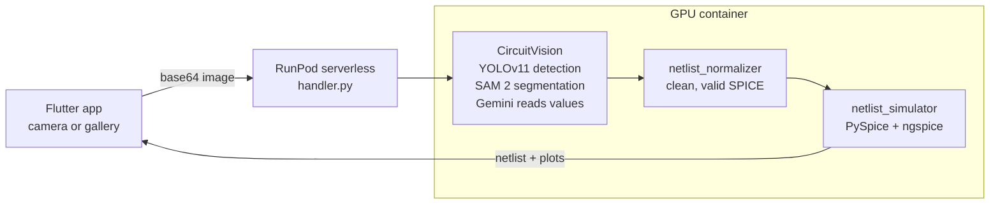

# CircuitVision

**Take a photo of a circuit diagram and get a SPICE netlist and simulation plots on your phone.**

A Flutter app sends the photo to a GPU endpoint on RunPod. There, the CircuitVision pipeline finds the components, traces the wires and reads the component values. The result is turned into a clean SPICE netlist, simulated with ngspice, and the netlist and plots come back to the app.

## How it works



1. **Capture.** Take a photo or pick one from the gallery. The app uploads it and polls the job until it finishes.
2. **Image to netlist.** The CircuitVision pipeline in [`CircuitVision/`](CircuitVision/) detects the components with a fine-tuned YOLOv11, segments the wires with SAM 2 to work out the nodes, and uses Gemini to read labels and values.
3. **Normalize.** `netlist_normalizer.py` turns CircuitVision's component list into a netlist ngspice accepts: it checks every component line and the ground reference, and adds the title, a default `.tran` analysis and `.end` when they're missing.
4. **Simulate.** [`netlist_simulator/`](netlist_simulator/) runs ngspice and plots node voltages and branch currents.
5. **Results.** The app shows the netlist (with a copy button) and the plots.

## Repository layout

```
flutter_app/        Flutter app: capture, home and results screens, RunPod client
backend/            RunPod serverless worker
  handler.py          Entry point: decode image, run the pipeline, return netlist and plots
  src/pipeline.py     Image → netlist → simulation pipeline
  src/netlist_normalizer.py
  tests/              21 unit tests for the normalizer
  Dockerfile*         Full, fast and slim images
CircuitVision/      Image-to-netlist models and pipeline, with its Streamlit web app
netlist_simulator/  PySpice/ngspice simulation and plotting
.github/workflows/  Builds the worker image and pushes it to Docker Hub on every change
```

## Run it

```bash
git clone https://github.com/Si7li/CircuitVision.git
cd CircuitVision
```

### Backend

Needs Python 3.10+, ngspice (`sudo apt install ngspice`) and a [Gemini API key](https://aistudio.google.com/apikey).

```bash
cd backend
pip install -r requirements.txt
pip install -e ../netlist_simulator
cp .env.example .env              # then add your GEMINI_API_KEY

python ../CircuitVision/download_models.py   # YOLO and SAM 2 weights
python test_local.py --sim-only               # quick check of the simulation step
pytest tests                                  # normalizer unit tests
```

### Deploy to RunPod

```bash
docker build -f backend/Dockerfile -t circuitvision-runpod .
docker tag circuitvision-runpod <your-dockerhub>/circuitvision-runpod:latest
docker push <your-dockerhub>/circuitvision-runpod:latest
```

Create a RunPod serverless endpoint from that image (any NVIDIA GPU, RTX 3060 or better), set `GEMINI_API_KEY` in its environment and note the endpoint ID. The GitHub Actions workflow does the build and push for you if you add `DOCKERHUB_USERNAME` and `DOCKERHUB_TOKEN` as repository secrets. The full request and response format is in [`backend/README.md`](backend/README.md).

### Flutter app

```bash
cd flutter_app
flutter pub get
flutter run -d linux \
  --dart-define=RUNPOD_ENDPOINT_ID=<your-endpoint-id> \
  --dart-define=RUNPOD_API_KEY=<your-runpod-api-key>
```

The repo includes the Linux desktop target. For a phone, generate the platform folders first with `flutter create --platforms=android,ios .`, then `flutter run`.

Passing the RunPod key with `--dart-define` is fine for testing. In a published app, put a small proxy in front of RunPod so the key never ships inside the app; `ProxyConfig` in `lib/services/api_config.dart` is ready for it.

## Credits

- The image-to-netlist app in [`CircuitVision/`](CircuitVision/) was first published at [JKc66/CircuitVision](https://github.com/JKc66/CircuitVision) under the Apache-2.0 license, kept in [`CircuitVision/LICENSE`](CircuitVision/LICENSE); its README lists its contributors.
- [Ultralytics YOLO](https://github.com/ultralytics/ultralytics), [SAM 2](https://github.com/facebookresearch/sam2) by Meta, [Google Gemini](https://ai.google.dev/), [ngspice](https://ngspice.sourceforge.io/), [PySpice](https://github.com/PySpice-org/PySpice), [RunPod](https://www.runpod.io/).

## License

The Flutter app, the backend, the simulator and the workflow are MIT licensed, see [LICENSE](LICENSE). [`CircuitVision/`](CircuitVision/) is Apache-2.0, see [`CircuitVision/LICENSE`](CircuitVision/LICENSE).
